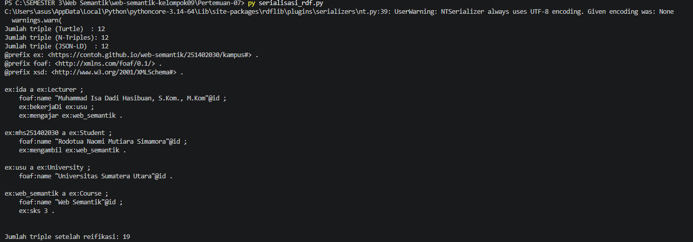

# Pertemuan 7 - Serialisasi RDF

## Artefak
- Graf asal: 8 triple (isi sesuai output `Jumlah triple` pada program)
- Format ekspor: Turtle, JSON-LD, N-Triples
- Nama graf: https://contoh.github.io/graph/kampus dan https://contoh.github.io/graph/fakultas

## Reifikasi dan provenance
- Triple yang dianotasi: ex:ida ex:mengajar ex:web_semantik, direpresentasikan oleh node `ex:stmt-01` bertipe `rdf:Statement`
- Creator : ex:ida
- Date    : 2026-10-01 (xsd:date)
- Source  : "Data akademik kampus"

## Langkah 1 - Membandingkan Serialisasi RDF

RDF dapat disimpan dalam berbagai format serialisasi. Setiap format memiliki karakteristik dan fungsi yang berbeda, sehingga penggunaannya perlu disesuaikan dengan kebutuhan pengolahan, pertukaran, dan pengelolaan data.

| Format | Kekuatan utama | Skenario tepat |
|---|---|---|
| Turtle | Memiliki struktur penulisan yang ringkas dan mudah dipahami oleh manusia | Cocok digunakan untuk menulis, memeriksa, dan mendokumentasikan data RDF secara manual |
| JSON-LD | Menggunakan struktur JSON sehingga mudah diterapkan pada aplikasi berbasis web | Sesuai untuk pertukaran data melalui API serta penyisipan data terstruktur pada halaman HTML |
| RDF/XML | Merepresentasikan data RDF menggunakan sintaks XML | Tepat digunakan ketika harus berintegrasi dengan sistem atau aplikasi lama yang masih menggunakan XML |
| N-Triples | Menuliskan setiap triple dalam satu baris sehingga formatnya sederhana dan konsisten | Cocok untuk dataset berukuran besar, pemrosesan data per baris, serta membandingkan perubahan data menggunakan Git |
| N-Quads | Memiliki struktur seperti N-Triples, tetapi dilengkapi informasi konteks graf | Digunakan ketika dataset terdiri atas beberapa named graph atau ketika data perlu dibedakan berdasarkan sumber maupun konteksnya |

> **Catatan:** Setiap format RDF memiliki keunggulan masing-masing. Oleh karena itu, pemilihan format perlu disesuaikan dengan kebutuhan. Turtle lebih mudah dibaca manusia, JSON-LD sesuai untuk web dan API, RDF/XML berguna untuk kompatibilitas dengan sistem lama, N-Triples cocok untuk pemrosesan data per baris, sedangkan N-Quads digunakan ketika data membutuhkan informasi konteks melalui named graph.

## Perbandingan
- Format paling mudah dibaca manusia: **Turtle**, karena prefix menyingkat IRI yang panjang dan tanda `;` serta `,` menghilangkan pengulangan sehingga struktur datanya terbaca seperti kalimat dan lebih ringkas.
- Format untuk HTML/API: **JSON-LD**, karena berbasis JSON sehingga langsung bisa diproses JavaScript dan API web, dan dapat disisipkan ke halaman HTML `<script type="application/ld+json">` tanpa mengubah tampilan halaman.
- Perbedaan reifikasi klasik dan RDF-star: reifikasi klasik harus membongkar sebuah pernyataan menjadi resource `rdf:type rdf:Statement` dengan `rdf:subject`, `rdf:predicate`, dan `rdf:object` (4 triple) sebelum metadata bisa ditambahkan, dan triple aslinya tetap berdiri terpisah. Pada contoh ini total 7 triple, dan triple aslinya tetap berdiri terpisah dari `stmt-01`. RDF-star menyematkan triple langsung sebagai subjek, misalnya `<< ex:ida ex:mengajar ex:web_semantik >> dct:creator ex:ida .`, sehingga satu anotasi cukup satu baris, tanpa node perantara, dan hubungan ke pernyataan asli eksplisit. Hasilnya lebih ringkas dan mudah dibaca, tetapi dukungan tool-nya belum seluas reifikasi klasik (rdflib yang dipakai di sini belum mendukungnya secara bawaan).

## Mengapa reifikasi klasik lebih verbose?
Karena satu pernyataan harus "dipecah" menjadi komponennya (subjek, predikat, objek) pada node baru, baru kemudian diberi anotasi. Satu triple dengan tiga metadata menjadi tujuh triple, sedangkan RDF-star cukup satu triple tertanam ditambah anotasinya.

## Refleksi
1. Named graph berguna saat menggabungkan data dari sumber yang berbeda karena setiap kumpulan triple dapat disimpan dalam graf yang memiliki konteks atau identitas sumbernya masing-masing. Dengan begitu, asal data tetap dapat diketahui, data dari sumber tertentu dapat dikelola atau diperbarui tanpa memengaruhi sumber lain, dan perbedaan maupun konflik antar sumber lebih mudah ditelusuri.
2. Provenance penting untuk sebuah triple karena memberikan informasi mengenai asal-usul dan konteks data, seperti siapa yang menyatakan data tersebut, dari sumber mana, dan kapan data dibuat atau diperoleh. Informasi ini membantu menilai kepercayaan data, membandingkan data yang berbeda, serta memudahkan proses pengecekan dan audit apabila terdapat kesalahan atau konflik.
3. Saya memilih format N-Triples untuk git diff karena setiap triple ditulis dalam satu baris secara sederhana dan konsisten. Hal ini membuat perubahan pada data lebih mudah terlihat karena penambahan, penghapusan, atau perubahan triple dapat dibandingkan secara langsung tanpa terganggu oleh prefix, indentasi, atau struktur penulisan seperti pada Turtle.

## Tangkapan layar
- 
- `tangkapan layar/output-named-graph.png`
